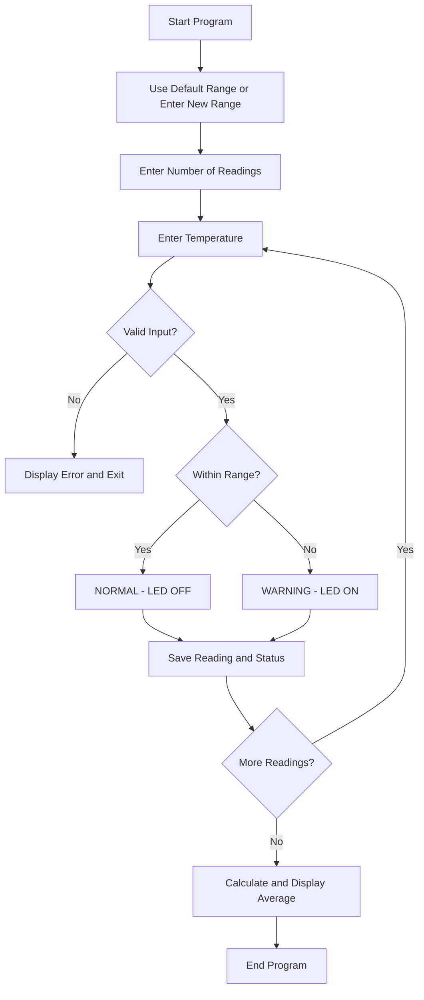

# Smart Classroom Comfort Monitor

## System Design

### 1. Project Overview

The Smart Classroom Comfort Monitor is a C program designed to run on a Raspberry Pi 4. It allows users to enter classroom temperatures and checks whether they are within an acceptable range.

The program displays NORMAL or WARNING, calculates averages, and saves temperature readings to files. An LED will be connected to the Raspberry Pi in class to indicate warning conditions.

### 2. System Components

Hardware:

- Raspberry Pi 4
- Red LED
- 1,000-ohm resistor
- Breadboard
- Jumper wires

Software:

- C programming language
- Raspberry Pi GPIO interface (planned)
- CSV file for temperature records
- Text file for the latest system status

### 3. System Workflow

1. User chooses whether to change the acceptable temperature range.
2. The program uses the default range of 68-76 F or the new range entered by the user.
3. User enters the number of temperature readings.
4. User enters each temperature in Fahrenheit.
5. Program validates the input.
6. Program checks whether the temperature is within the selected range.
7. If the temperature is within range, display NORMAL and LED OFF.
8. If the temperature is outside the range, display WARNING and LED ON.
9. Save the temperature and status to a CSV file.
10. Update status.txt with the latest status.
11. Repeat until all readings are entered.
12. Calculate and display the average temperature.

### 3.1 System Diagram

Note: The current program displays simulated LED states. Physical GPIO control will be added and tested on the Raspberry Pi.

### 4. Hardware Integration

The red LED will be connected to GPIO17 (physical pin 11) through a 1,000-ohm resistor.

The positive leg of the LED connects through the resistor to GPIO17. The negative leg connects to a Raspberry Pi ground pin.

The program will control the LED using the GPIO interface:

- HIGH = LED ON
- LOW = LED OFF

Expected behavior:

- NORMAL: LED OFF
- WARNING: LED ON

GPIO integration and physical LED testing are still pending. The current program only displays simulated LED states.

### 5. Data Storage

data/temperature_log.csv:

- Stores the timestamp, temperature, and status.
- Adds new readings without deleting previous records.

status.txt:

- Stores the latest NORMAL or WARNING status.
- Updates whenever a new reading is saved.

### 6. System Inputs and Outputs

Inputs:

- Classroom temperature in Fahrenheit
- Number of temperature readings
- Minimum acceptable temperature
- Maximum acceptable temperature

Outputs:

- NORMAL or WARNING message
- Simulated LED ON or OFF message
- Average temperature
- Saved temperature records
- Latest system status

### 7. Testing and Current Status

The program was compiled and tested using Ubuntu WSL and GCC 13.3.0.

All 21 documented software tests passed, including normal temperatures, warning conditions, custom ranges, file saving, averages, and invalid inputs.

The remaining work is to run the program on the Raspberry Pi, connect the physical LED, and verify GPIO control in class.
